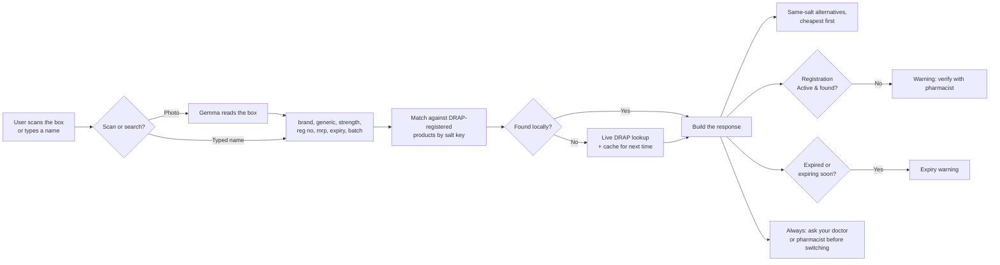
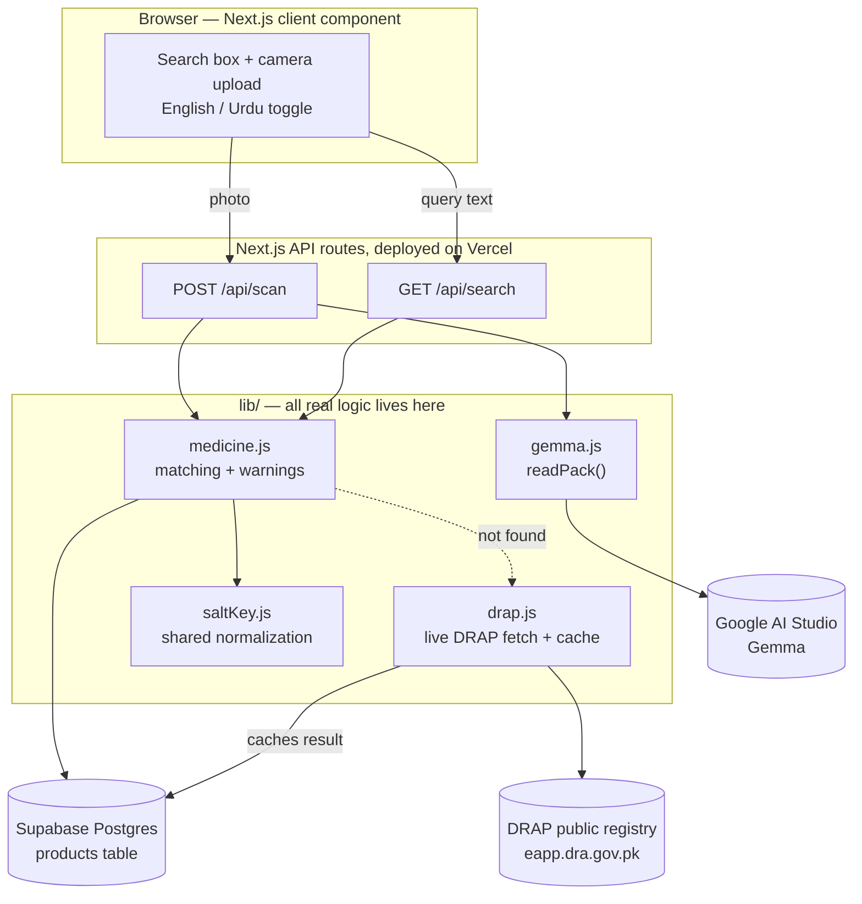
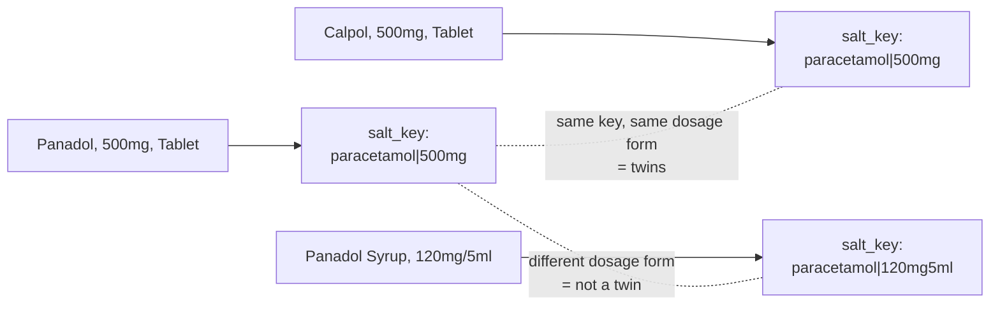
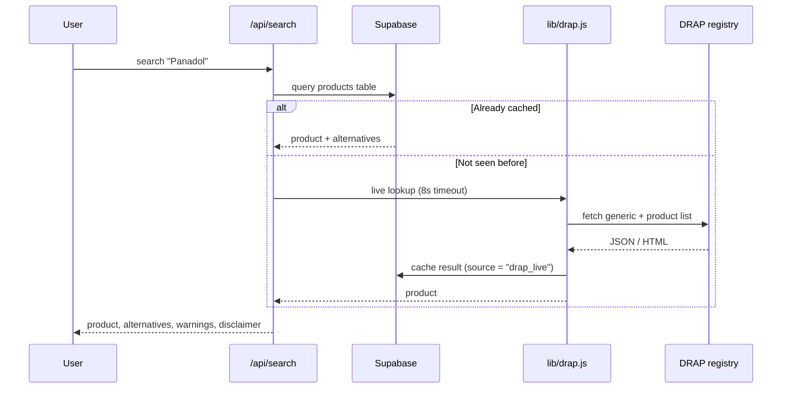

# PillTwin

**Find your medicine's twin.**

Scan a medicine box. PillTwin reads it with Google's **Gemma**, matches it against Pakistan's official drug registry, and shows every other registered medicine with the **same salt, same strength, and same dosage form** — so patients can see cheaper alternatives before they pay, and get a clear warning if the pack looks fake or unregistered.

Built in 24 hours for a hackathon that required Gemma as the reading model.

---

## The problem

In Pakistan, patients are handed a box at the pharmacy with no easy way to answer three questions:

1. **Is there a cheaper version of this exact medicine?** Brand names for the same salt can differ in price by 2-5x, and nobody has time to cross-check DRAP's registry by hand.
2. **Is this pack even real?** Counterfeit and unregistered medicines circulate, and the only public check is a clunky government web page most patients don't know exists.
3. **Is it still good to use?** Expiry dates are printed in half a dozen formats and easy to miss.

DRAP (the Drug Regulatory Authority of Pakistan) publishes the registry, but there's no app, no price comparison, and no simple way to point a phone camera at a box and get an answer.

## The idea

Point your phone at the box. PillTwin does the rest.



No login. No app store. Open the site, scan or type, get an answer in seconds.

## How it's built



Every route is a thin wrapper — `app/api/*/route.js` just validates input and calls into `lib/`. That's the whole backend.

## Matching logic: the "twin" check

Two products are twins when their **salt key** matches — sorted, lowercased ingredient names plus strength, with the dosage form matched separately so a tablet is never offered as a "twin" of a syrup.



The exact same `makeSaltKey` function in `lib/saltKey.js` runs in the bulk scraper, the live DRAP fetch, and the search/scan API — one implementation, used everywhere, so a product never gets a different key depending on which code path found it.

**Lookup priority:** registration number (unique, most reliable) → brand name + strength → generic name → live DRAP lookup as a last resort.

## Hybrid data strategy: instant for common drugs, live for everything else

DRAP's registry has no API — just one scrapeable endpoint — so PillTwin pre-loads common generics into Supabase for instant answers, and falls back to a live, cached lookup for anything it hasn't seen yet.



If DRAP is slow or down, the backend fails gracefully: it returns whatever is already cached and tells the user live lookup is unavailable — the demo never crashes because a government website hiccupped.

## Safety first

PillTwin never tells anyone to switch medicine on their own. Every result screen carries:

> "Always ask your doctor or pharmacist before switching medicines."

And every unregistered or inactive registration is phrased carefully — **"registration not found, verify with pharmacist"** — never a flat "this is fake."

## Features

| Feature | Status |
|---|---|
| Scan a box → Gemma reads it → see same-salt alternatives | Done |
| Manual search by brand or generic name | Done |
| Fake / unregistered medicine warning (DRAP status check) | Done |
| English / Urdu toggle, right-to-left for Urdu | Done |
| Expiry warning (reads the printed date, warns if expired or expiring within 90 days) | Done |
| Live DRAP lookup wired into search/scan (beyond the pre-loaded CSV) | In progress |
| Overcharge check (price paid vs. printed MRP) | Planned |
| Risky-to-switch warning (levothyroxine, warfarin, antiepileptics, etc.) | Planned |

Prices (MRP, pack size) are nullable throughout — DRAP's registry has no price data, so PillTwin never invents one. Unpriced alternatives sort after priced ones and show "price not available."

## Tech stack

- **Next.js (App Router), JavaScript only** — no TypeScript
- **Tailwind CSS**
- **Supabase (Postgres)** for the product registry cache
- **Gemma**, via Google AI Studio (`@google/genai`), reads the box photo
- **Deployed on Vercel**

## Project structure

```
app/
  page.js                 # home: scan button + search box + language toggle
  api/scan/route.js       # POST — photo in, matched product + alternatives out
  api/search/route.js     # GET  — name in, matched product + alternatives out
lib/
  supabase.js             # server-side Supabase client
  gemma.js                # readPack(image) — calls Gemma, retries, parses JSON
  drap.js                 # live DRAP fetch + parse + cache
  medicine.js             # findProduct, findAlternatives, buildWarnings
  saltKey.js              # makeSaltKey + cleaning helpers (shared everywhere)
  i18n.js                 # English / Urdu strings + warning text
scripts/
  drap-scraper.js         # bulk pre-load of common generics → drap_products.csv
fixtures/
  gemma-pack.json         # a saved real Gemma response, for offline dev
```

## Getting started

```powershell
# install dependencies
npm install

# copy the example env file and fill in your own keys
copy .env.local.example .env.local
```

`.env.local` (server-only — never commit this, never prefix with `NEXT_PUBLIC_`):

```
SUPABASE_URL=
SUPABASE_SERVICE_ROLE_KEY=
GEMINI_API_KEY=
```

```powershell
npm run dev            # start the dev server → http://localhost:3000
npm run build          # production build
npm start               # run the production build
npm run lint            # eslint
```

Bulk-load the registry (run with Node directly, not through npm):

```powershell
node scripts/drap-scraper.js                          # scrape all generics → drap_products.csv
node scripts/drap-scraper.js --probe "Paracetamol"    # one generic only, for inspection
```

## API reference

### `GET /api/search?q=<name>`

```json
{
  "product": { "brand": "Panadol", "generic": "Paracetamol", "strength": "500mg", "...": "..." },
  "alternatives": [ { "brand": "Calpol", "mrp": null, "...": "..." } ],
  "warnings": [],
  "disclaimer": "Always ask your doctor or pharmacist before switching medicines.",
  "dataNote": "Data from DRAP's provisional registry; may contain errors."
}
```

### `POST /api/scan` — multipart form, field name `image`

```json
{
  "pack": { "brand": "Panadol", "expiry": "06/2027", "mrp": 45, "...": "..." },
  "product": { "...": "matched DRAP record" },
  "alternatives": [ "..." ],
  "warnings": [
    { "code": "STATUS_NOT_ACTIVE", "message": "..." },
    { "code": "EXPIRING_SOON", "message": "..." }
  ],
  "disclaimer": "Always ask your doctor or pharmacist before switching medicines.",
  "dataNote": "Data from DRAP's provisional registry; may contain errors."
}
```

Every route validates input, wraps its body in try/catch, and returns a plain-English `{ "error": "..." }` on failure — never a raw stack trace.

## Data source

Everything comes from DRAP's public product registry at `eapp.dra.gov.pk`. There's no official API; PillTwin uses the one internal endpoint the registry's own web page calls, scraped politely (~1.5s between requests) and cached in Supabase. DRAP's own disclaimer says the list is provisional — PillTwin repeats that honestly in the UI rather than presenting it as gospel.

---

*PillTwin is an information tool, not a medical authority. It never tells you to switch medicines on your own — always confirm with a pharmacist or doctor.*
